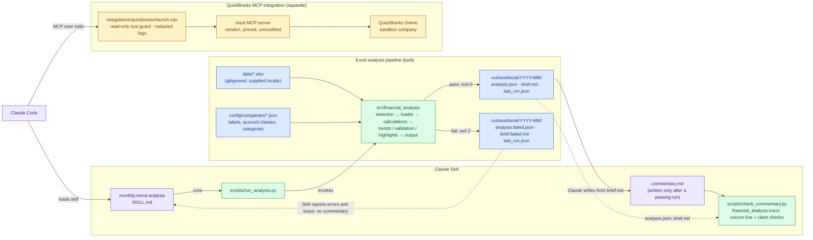

<div align="center">

# Financial Intelligence Engine

**A Claude Skill for monthly financial trend analysis, backed by a deterministic Python engine, golden evaluations and a hardened read-only QuickBooks MCP connection.**

<p>
  
  
  
  
  <br>
  
  
  
  
</p>

</div>

---

## Overview

This is a build exercise for RE Financial Services: connect QuickBooks Online to Claude, and turn monthly financial-statement analysis into a Claude Skill backed by deterministic code and tests.

- **Python does every calculation.** The engine in `src/financial_analysis/` loads the workbook, calculates and validates every figure, and writes `analysis.json` and `brief.md`.
- **Claude only interprets.** The Skill runs the engine, stops if validation fails, and writes owner-facing commentary from the validated output. A checker then rejects commentary whose figures, directions or causes the analysis does not support.
- **Two separate parts.** The Excel analysis pipeline reads the supplied workbook only. The QuickBooks MCP integration is a separate, read-only connection to a sandbox company; the Skill does not query QuickBooks.

| Part | Deliverable | Status |
|---|---|---|
| 1. QuickBooks ↔ Claude | Read-only MCP connection to a sandbox company | Working. [Integration README](integrations/quickbooks/README.md), [decision record](docs/integration-decision.md) |
| 2. Trend-analysis skill | [`.claude/skills/monthly-trend-analysis`](.claude/skills/monthly-trend-analysis/SKILL.md) and its Python pipeline | Working on the supplied workbook; covered by the pytest suite (tests that need the workbook skip without it, see [Quick start](#quick-start)) |
| 3. Eval suite (5+ golden cases) | [`evals/golden_cases`](evals/golden_cases/README.md) | **Working.** 10 golden cases (281 checks) on synthetic workbooks, graded against hand-calculated expectations; `python evals/golden_cases/run_golden.py` exits 1 on any regression; also run by pytest. Commentary is checked automatically for misattributed and contradicted figures, forecasts and unsupported causes (`tests/test_commentary_claims.py`); its overall quality is a manual rubric |
| 4. One-page architecture note | [`docs/architecture.md`](docs/architecture.md) | Written. Separates what is built from what is proposed; multi-client isolation is a proposal and is **not** enforced by the current code |

## Contents

- [Overview](#overview)
- [Architecture](#architecture)
- [Features](#features)
- [Evaluation results](#evaluation-results)
- [Repository layout](#repository-layout)
- [Quick start](#quick-start)
- [Running the analysis](#running-the-analysis)
- [Using the Claude Skill](#using-the-claude-skill)
- [How the financial analysis works](#how-the-financial-analysis-works)
- [QuickBooks integration](#quickbooks-integration)
- [Documentation](#documentation)
- [Limitations and design decisions](#limitations-and-design-decisions)

## Architecture

The two parts share a repository and a Claude Code project, but no code or data path: the analysis reads Excel only, and the QuickBooks connection is a separate MCP server.



Blue: data and outputs. Green: deterministic Python. Purple: Claude. Amber: QuickBooks. Claude Code hosts both the Skill and the QuickBooks MCP connection, but no arrow joins the two: the analysis never reads QuickBooks. The full note, including hosting and the ten-client design, is in [docs/architecture.md](docs/architecture.md).

## Features

**🧮 Deterministic analysis engine**
Finds months, sections, `Total …` rows and calculated lines by structure, with no account names in code. Sums individual accounts only, reconciles every subtotal and derived line, and calculates MoM, YoY, TTM and YTD views.

**🛡️ Validation that fails closed**
Missing months, blank cells (never treated as zero), text in number cells, duplicate months, subtotal mismatches and unrecognised sections with amounts are reported. Validation failures return exit code 2 and write failure outputs; the Skill stops without generating commentary.

**🔁 Reusable across companies**
A new company needs a JSON config, not a code change. A test fails if the Skill's instructions name a configured company, account, month or amount.

**🔎 Commentary provenance and claim checks**
Each commentary carries a source line (period, workbook SHA-256, `analysis_id`). The checker rejects misattributed or contradicted figures, forecasts and unsupported causes.

**✅ Golden evaluations**
Hand-calculated expectations on synthetic workbooks, run through the real CLI, with freshness checks on every output.

**🔐 Hardened, read-only QuickBooks tools**
Create, update and delete tools are never registered, the launcher accepts the sandbox only, logs are redacted, and credentials stay outside the repository.

## Evaluation results

Last verified on 2026-10-15 with the supplied workbook present in `data/`:

| Suite | Command | Result |
|---|---|---|
| Golden evaluation cases | `.venv\Scripts\python evals/golden_cases/run_golden.py` | 10 cases, 281 checks, all pass |
| Python test suite | `.venv\Scripts\python -m pytest` | 195 tests, all pass |
| QuickBooks launcher tests | `npm test` in `integrations/quickbooks` | 20 tests, all pass (offline, fake credentials) |

The supplied workbook is client data and is gitignored, so it is **not** in a fresh clone. There, the tests that read it skip themselves (see [Quick start](#quick-start)); the golden cases and every other test build small synthetic workbooks and run as normal.

Case-by-case expectations, the grading method, the regression faults the suite has been shown to catch, and the manual commentary rubric are in [evals/golden_cases/README.md](evals/golden_cases/README.md).

## Repository layout

```
.mcp.json                         QuickBooks MCP server config (no secrets)
.claude/settings.json             Deny rules for credential files
.claude/skills/monthly-trend-analysis/  The Claude Skill: SKILL.md, runner script, references
config/companies/                 Per-company settings: account classes, expense categories
data/                             Source workbook (read-only input; gitignored, so place it here locally)
docs/                             Architecture note, integration decision, security (assignment brief PDF kept locally, not committed)
evals/golden_cases/               Golden cases, fixture generators and the grading runner
integrations/quickbooks/          Hardened MCP launcher + tests, dependency patch, setup, OAuth, troubleshooting
src/financial_analysis/           Deterministic pipeline: load → calculate → validate → highlight → output
tests/                            pytest suite (small hand-built workbooks + the ABC workbook)
vendor/                           Intuit's QuickBooks MCP server, built locally (gitignored)
out/                              Analysis outputs (gitignored; contains client figures)
```

## Quick start

Requirements: Python 3.11+, and Node.js 20+ for the QuickBooks launcher tests. Run from the repository root in Windows PowerShell:

```powershell
python -m venv .venv
.venv\Scripts\pip install -e ".[dev]"
.venv\Scripts\python -m pytest                          # full Python suite, including one test per golden case
.venv\Scripts\python evals/golden_cases/run_golden.py   # golden evaluation report; exit 1 on any regression
```

The QuickBooks launcher has its own offline tests (Node.js 20+, no network, fake credentials):

```powershell
cd integrations/quickbooks; npm test; cd ../..
```

Connecting to a sandbox is described in [integrations/quickbooks/README.md](integrations/quickbooks/README.md).

> [!NOTE]
> Neither the supplied workbook nor any credentials are in this repository. Place the supplied workbook in `data/` to run every test. It is client data and is never committed, so in a fresh clone the tests that read it skip themselves: `tests/test_abc_workbook.py` (the pipeline against the totals Excel cached in the workbook) and one or two tests each in `tests/test_provenance_safeguards.py`, `tests/test_data_reliability.py` and `tests/test_commentary_claims.py`. Every other test builds small synthetic workbooks in a temporary directory.

## Running the analysis

```powershell
.venv\Scripts\python.exe .claude/skills/monthly-trend-analysis/scripts/run_analysis.py "data/ABC Inc - Financial Statements (1) (1).xlsx" --config config/companies/abc-inc.json
```

This is the supported command. It applies the skill's input rules:

- **Workbook.** It must be an `.xlsx`/`.xlsm` file inside the repository's `data/` folder. If you omit the path, the only workbook in `data/` is used. If there are several, the run stops and lists them so you can choose one. A listing order is never used to choose.
- **Config.** `--config` (or `--no-config` for an onboarding run) is required.
- **Company.** The config's `company_name` must match the company named in the workbook's title. If it does not, or the title names no company, the run stops. Add `--confirm-company "<company_name>"` only after a person has confirmed that the workbook belongs to that company.

The runner works from any directory and needs only `openpyxl` in the environment, not an installed package: it finds the repository root and puts `src/` on the import path itself.

`python -m financial_analysis <workbook> [options]` runs the same CLI, but only when the package is importable. Either install it with `pip install -e .` (the Quick start does this), or point `PYTHONPATH` at `src` (PowerShell: `$env:PYTHONPATH = "src"`). Without one of those it fails with `No module named financial_analysis`. Unlike the runner, it writes `out/` relative to the current directory. It also restricts the workbook's location or requires a config only when given `--input-dir DIR` or `--require-config`, which the runner always passes. It checks the company whenever the config has a `company_name`.

### Outputs and exit codes

Outputs go to `out/<workbook>/<YYYY-MM>/`. Add `--period YYYY-MM` to analyse another month. A folder only ever holds the analysis of one workbook content (SHA-256). If it holds outputs from a different workbook, for example another file saved under the same name, they are first moved unchanged into `superseded-<sha256 prefix>-<UTC time>/` inside it.

| Exit code | Meaning | Files written |
|---|---|---|
| `0` | Validation passed, possibly with warnings | `analysis.json` (full structured result), `brief.md` (reviewer brief), `last_run.json`. If the figures changed since an existing `commentary.md` was written, that file is renamed to `commentary.stale.md`. `last_run.json` records the run's `analysis_id` (a hash of the analysis) and time, and the set-aside commentary's own source line, or null if it had none |
| `2` | Validation failed, including when a headline figure for the analysis month cannot be calculated because a cell is blank or invalid (`required_metric_unavailable`) | `analysis.failed.json`, `brief.failed.md`, `last_run.json`. Earlier `analysis.json`, `brief.md` and `commentary.md` of the same workbook are left untouched, listed in `last_run.json` as stale, and named in `brief.failed.md` as belonging to an earlier run |
| `1` | No workbook could be chosen safely (none, several, outside `data/`, not Excel), it could not be read, the config is missing or invalid (the message names the key), or the config's company does not match the workbook and was not confirmed | Nothing |

How to read the outputs: `brief.md` is the reviewer brief (validation status first, then rounded figures, assumptions and limitations); `analysis.json` holds every series at 2 dp, described field by field in [output-schema.md](.claude/skills/monthly-trend-analysis/references/output-schema.md).

## Using the Claude Skill

Start Claude Code in the repository or any folder inside it (no setup step: the skill is discovered automatically) and ask for a monthly trend analysis, or invoke `/monthly-trend-analysis`. The Skill runs the pipeline and stops if validation fails. Otherwise it writes owner-facing commentary to `out/.../commentary.md` using only figures from the pipeline output, then checks it:

```powershell
.venv\Scripts\python.exe .claude/skills/monthly-trend-analysis/scripts/check_commentary.py "out/<workbook name>/<YYYY-MM>"
```

Exit `0` means the source line matches the saved analysis and no finding was raised; `3` lists content findings (`UNTRACED`, `MISATTRIBUTED`, `CONTRADICTS`, `FORECAST`, `UNSUPPORTED_CAUSE`); `4` means the source line or the folder's outputs are stale or inconsistent; `1` means a file is missing.

### Skill location

The skill lives in `.claude/skills/monthly-trend-analysis/`, Claude Code's documented project-skill location. It is committed there as the single copy. Claude Code loads it in a session started in the repository or any folder inside it, with no links, scripts or install step. This was checked with Claude Code 2.1.296: the skill is listed in sessions started at the root, in `tests/` and in `src/financial_analysis/`, and not in a session started outside the repository.

Two alternatives were rejected:

- **A top-level `skills/` directory.** Claude Code only discovers that as part of a plugin. Making the repository root a plugin would also load the root `.mcp.json` as a second, plugin-scoped QuickBooks server, and would need a marketplace and an install step.
- **A junction or symlink into `.claude/skills/`.** This needs setup on every clone, and git follows junctions on Windows.

The skill's runner locates the repository root itself and is independent of the current directory. The Python engine in `src/` has no dependency on Claude Code and runs on its own with `python -m financial_analysis`.

## How the financial analysis works

All of the arithmetic is done in Python; Claude only interprets the results.

- **Loading.** The loader finds the month columns, sections, `Total …` rows and calculated lines from the workbook's structure. It contains no account names. Only individual accounts are ever summed, and the workbook's own totals are used just to reconcile against. That is how double-counting is prevented.
- **Checks.** These include:
  - every subtotal against its accounts;
  - reported gross profit, operating income and net income against the calculated figures;
  - the balance sheet balancing;
  - the month-to-month change in current-year earnings against net income;
  - missing months, blank cells (never treated as zero), text in number cells and duplicate months.
- **Metrics.** Revenue (by stream), cost of goods sold, gross profit and margin, operating expenses (as presented, by category, and "core" excluding configured non-operating accounts), operating and net income. Each comes with MoM, YoY, TTM and YTD views. Balance-sheet figures are month-end balances and are never summed into TTM.
- **New companies.** Another company needs a JSON file in `config/companies/`, not a code change. See [company-config.md](.claude/skills/monthly-trend-analysis/references/company-config.md).
- **Output format.** See [output-schema.md](.claude/skills/monthly-trend-analysis/references/output-schema.md).
- **Commentary provenance.** Each commentary ends with the source line from `brief.md` (analysis period, workbook SHA-256, `analysis_id`). `python -m financial_analysis.trace <out folder>` checks that line against the saved `analysis.json`, then checks the content (`claims.py`). A number in a sentence that names a metric, account, category or balance-sheet figure must be one of that item's figures, for a month the sentence names or the analysis month. Its sign, direction words and "profit"/"loss" must agree with the analysis. Forecast numbers, and causes stated as fact without a figure from the analysis, are rejected; a labelled hypothesis or a question is not. A number in a sentence that names nothing must be printed in `brief.md`. This is a guard, not a proof; see the limitations in `claims.py`. It also rejects (exit 4) a folder whose latest run failed, or whose `brief.md`, `analysis.json` and `last_run.json` describe different runs. `last_run.json` alone never makes a commentary pass.

### Accounting decisions awaiting confirmation (ABC Inc)

These come from `config/companies/abc-inc.json` or the workbook. Engineering drafted them; the pipeline reports them as configured and does not change them. They need the accounting team's confirmation before client use:

1. Interest Expense and Interest Income are classed as non-operating, and Income Tax Benefit as income tax, so "core" figures exclude all three. The workbook itself places them in Operating Expenses, so "as presented" operating figures include them.
2. The category name "Interest & income tax (non-operating)" groups an income-tax item with interest under a non-operating label.
3. Federal & State Taxes stays an operating expense; the workbook does not say whether it is an income tax.
4. The workbook places Sales Commission and Referral Fees in Cost of Goods Sold, which affects gross margin.
5. The operating-expense categories and the highlight materiality thresholds.

## QuickBooks integration

Claude Code starts Intuit's open-source MCP server (`vendor/quickbooks-online-mcp-server`, pinned commit, unmodified source) over stdio, through the hardened launcher `integrations/quickbooks/launch.mjs`, as configured in `.mcp.json`:

- Credentials live in `~/.secrets/qbo/sandbox.env` (Windows: `%USERPROFILE%\.secrets\qbo\sandbox.env`), outside the repo. The launcher refuses a token store inside the repository.
- Create, update and delete **tools** are never registered, enforced by the server's flags and independently by the launcher. The 71 read tools include P&L, balance sheet, trial balance and general ledger.
- It connects to the sandbox only; the launcher refuses any other environment.
- Logs are redacted and kept off the protocol channel. Interactive OAuth runs only through the one-time `launch.mjs --auth`, never mid-session.
- Tests: `cd integrations/quickbooks; npm test` (Node 20+, no network, fake credentials).

> [!IMPORTANT]
> The MCP **tools** are read-only, but the OAuth grant itself is **not**: Intuit's Accounting scope permits writes, so the stored refresh token is a write-capable credential for the sandbox company. See [Permissions: what is and is not read-only](integrations/quickbooks/README.md#permissions-what-is-and-is-not-read-only).

Setup, OAuth, token rotation, reconnection and team hosting are covered in [integrations/quickbooks/README.md](integrations/quickbooks/README.md) and [docs/integration-decision.md](docs/integration-decision.md). Credential and data rules are in [docs/security.md](docs/security.md).

The pipeline currently reads the Excel workbook only. The assignment's stretch goal (loading the workbook into the sandbox and running the same skill against QuickBooks data) is not implemented: no workbook data has been written to QuickBooks, and the skill does not query QuickBooks.

## Documentation

| Document | What it covers |
|---|---|
| [docs/architecture.md](docs/architecture.md) | One-page architecture: structure, memory, credentials, ten clients (built vs proposed) |
| [docs/integration-decision.md](docs/integration-decision.md) | Connection options considered, trade-offs, [team hosting proposal](docs/integration-decision.md#team-hosting) |
| [docs/security.md](docs/security.md) | Credential and data handling, [known gaps and risks](docs/security.md#known-gaps-and-risks) |
| [integrations/quickbooks/README.md](integrations/quickbooks/README.md) | Sandbox setup, OAuth, troubleshooting, dependencies and known vulnerabilities |
| [evals/golden_cases/README.md](evals/golden_cases/README.md) | Golden cases, grading, regression detection, commentary rubric |
| [SKILL.md](.claude/skills/monthly-trend-analysis/SKILL.md) | The Skill's instructions to Claude |
| [company-config.md](.claude/skills/monthly-trend-analysis/references/company-config.md) | Company config keys and onboarding checklist |
| [output-schema.md](.claude/skills/monthly-trend-analysis/references/output-schema.md) | `analysis.json` field reference, metric definitions, highlight rules |

## Limitations and design decisions

| Topic | Decision or limitation |
|---|---|
| Calculations | Python only. Claude never calculates; every figure in commentary must come from `brief.md` or `analysis.json` |
| Data source | The Excel workbook only. Running the Skill on live QuickBooks data (the stretch goal) is not implemented |
| QuickBooks permissions | Tool surface is read-only; the OAuth grant is write-capable. Sandbox only |
| Team hosting and multi-client isolation | **Proposals**, not built or tested. Today all workbooks and outputs share one tree with no client key or access control ([architecture](docs/architecture.md)) |
| Commentary checks | A guard, not a proof: a wrong claim with no number, a sentence naming nothing the checker recognises, or a margin change written in % instead of pp can pass. The reviewer remains the final control |
| Golden suite scope | Synthetic, income-statement-only fixtures in one layout family; commentary prose is graded by a manual rubric, not automatically |
| Accounting judgment | Classifications and categories are configured drafts awaiting accounting-team sign-off (see [above](#accounting-decisions-awaiting-confirmation-abc-inc)) |
| Workbook protection | Kept out of git by `.gitignore` only; see [known gaps](docs/security.md#known-gaps-and-risks) |
